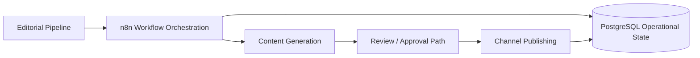

# RACB Content Platform

> **Governed content automation foundation for distinct personal and corporate editorial pipelines, with a first successful LinkedIn text-only publication test reported by the project owner.**

| Attribute | Current evidence status |
|---|---|
| Evidence level | **Repository-Documented Implementation + Owner-Reported Text Publication Acceptance** |
| Implementation repository | Private |
| Maturity | **Active Development** |
| Primary capability | Automation & Integration |
| Secondary capability | AI Operations & Governance |
| Orchestration | n8n |
| Operational data | PostgreSQL |
| Deployment foundation | Docker Compose |
| First publication | **LinkedIn text-only test passed (owner-reported)** |
| Carousel publishing | **Not yet validated** |
| Snapshot reviewed | 2026-10-10 |

## Overview

RACB Content Platform is being developed to automate content preparation, review and publication for RACBCONSULTING and its leadership, while preserving separate editorial identities and auditable operational state.

The first demonstrated publication milestone is a **successful text-only LinkedIn publication test**, confirmed by the project owner. This is a narrower claim than end-to-end approval, branded carousel generation, multi-account scheduling, or multi-channel production operations.

## The problem

Publishing consistent professional content across personal and corporate channels requires more than generating text. A reliable workflow must maintain editorial separation, operational history, credential boundaries, publication state and failure visibility.

**Content generated ≠ content approved ≠ content published.** Each stage requires its own evidence.

## Architecture

The diagram expresses the target workflow boundaries; **not every depicted step is independently validated as a completed production integration**.

## Implementation foundation

The private repository documents:

- n8n workflow artifacts for production, development and bootstrap.
- Dedicated Docker Compose infrastructure with PostgreSQL, a persistent volume and isolated network.
- Successful database bootstrap, seed data and seven created tables.
- Separate editorial intent for personal and corporate publishing.
- Renderer source and supporting engineering documentation.
- Investigation and a documented workaround for an n8n PostgreSQL expression-replacement issue.
- Git-based development and change history.

## First publication acceptance

**Owner-reported acceptance:** The first LinkedIn publication test completed successfully using **text only**, without carousel media.

This updates the earlier repository working-memory checkpoint, which still described the first publication as pending. That earlier record is treated as historical, not as proof that the later test failed.

**Evidence boundary:** The owner has confirmed the test result; the public case does not yet include a sanitized execution log, publication receipt or independently inspected post record. Accordingly, the test is not represented as independently verified production-wide automation.

## Verified technology profile

| Area | Documented implementation |
|---|---|
| Workflow orchestration | n8n |
| Persistent operational store | PostgreSQL |
| Environment | Docker Compose |
| Workflow artifacts | Development, production and bootstrap |
| Content generation | OpenAI integration planned and exercised within the reported text publication path, pending artifact-level verification |
| Media rendering | Renderer source present; end-to-end carousel output not validated |
| Publishing | LinkedIn text-only first acceptance reported |
| Source control | Git / private GitHub repository |

## Capabilities demonstrated

- Workflow-oriented automation design.
- Separation of personal and corporate editorial responsibilities.
- PostgreSQL-backed operational foundations.
- Reusable workflow artifacts and bootstrap practices.
- Investigation and documentation of workflow compatibility issues.
- First text-only LinkedIn publication acceptance, as reported by the owner.
- Explicit differentiation between development milestones and production readiness.

## Deliberate boundaries

The current snapshot does **not** establish:

- Successful branded carousel or image publishing.
- End-to-end validation of every approval path.
- Independently verified unattended recurring publication.
- Successful publishing to every planned account or channel.
- Full production operations, reliability metrics or multi-tenant readiness.

## Evidence classification

**REPOSITORY-DOCUMENTED IMPLEMENTATION** — infrastructure, workflow files, database bootstrap and engineering documentation are present in the private repository.

**OWNER-REPORTED PUBLICATION ACCEPTANCE** — a first text-only LinkedIn publication test passed, according to the project owner. Sanitized runtime evidence is still needed for an independently verifiable claim.

**ACTIVE DEVELOPMENT** — media, broader approval and publication capabilities remain subject to further validation.

## Disclosure boundary

Private workflows, credentials, publication tokens, personal account identifiers and internal operational data remain unpublished. Public material is limited to sanitized technical architecture, project milestones and explicit validation boundaries.

## Interested in this architecture?

RACB Content Platform is an internal RACBCONSULTING engineering project, not an open-source release. Its architecture illustrates governed content automation and integration of existing workflow components.

---

**Rene Canete / RACBCONSULTING**  
Technical Evidence Center
