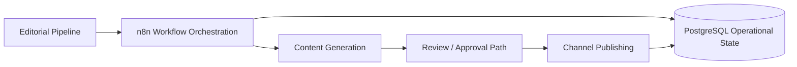

# RACB Content Platform

> **Governed content automation foundation for distinct personal and corporate editorial pipelines, currently paused while RACB Postmaker is prioritized.**

| Attribute | Current evidence status |
|---|---|
| Evidence level | **Repository-Documented Implementation + Infrastructure Bootstrap Validation** |
| Implementation repository | Private |
| Maturity | **Development Paused / Standby** |
| Primary capability | Automation & Integration |
| Secondary capability | AI Operations & Governance |
| Orchestration | n8n |
| Operational data | PostgreSQL |
| Deployment foundation | Docker Compose |
| Publication status | **No completed LinkedIn publication established for this project** |
| Carousel publishing | **Not yet validated** |
| Snapshot reviewed | 2026-10-10 |

## Overview

RACB Content Platform is being developed to automate content preparation, review and publication for RACBCONSULTING and its leadership, while preserving separate editorial identities and auditable operational state.

Development is currently on standby while RACB Postmaker, a separate LinkedIn-specific project, is prioritized. The successful LinkedIn text-only publication reported by the owner belongs to Postmaker, not to this Content Platform.

## The problem

Publishing consistent professional content across personal and corporate channels requires more than generating text. A reliable workflow must maintain editorial separation, operational history, credential boundaries, publication state and failure visibility.

**Content generated ≠ content approved ≠ content published.** Each stage requires its own evidence.

## Architecture

The diagram expresses the target workflow boundaries; **not every depicted step is independently validated as a completed production integration**.

## Implementation foundation

The private repository documents:

- n8n workflow artifacts for production, development and bootstrap.
- Dedicated Docker Compose infrastructure with PostgreSQL, a persistent volume and isolated network.
- Successful database bootstrap, seed data and seven created tables.
- Separate editorial intent for personal and corporate publishing.
- Renderer source and supporting engineering documentation.
- Investigation and a documented workaround for an n8n PostgreSQL expression-replacement issue.
- Git-based development and change history.

## Publication and development boundary

The repository's documented infrastructure/bootstrap work is distinct from a validated LinkedIn publication. No successful publication is established for RACB Content Platform at this checkpoint.

RACB Postmaker is a separate, LinkedIn-specific project. Its owner-reported successful text-only publication must not be attributed to this platform. Work on Content Platform is currently paused while Postmaker is prioritized.

## Verified technology profile

| Area | Documented implementation |
|---|---|
| Workflow orchestration | n8n |
| Persistent operational store | PostgreSQL |
| Environment | Docker Compose |
| Workflow artifacts | Development, production and bootstrap |
| Content generation | OpenAI integration planned; no completed publication path validated for this project |
| Media rendering | Renderer source present; end-to-end carousel output not validated |
| Publishing | No completed publication validated for this project |
| Source control | Git / private GitHub repository |

## Capabilities demonstrated

- Workflow-oriented automation design.
- Separation of personal and corporate editorial responsibilities.
- PostgreSQL-backed operational foundations.
- Reusable workflow artifacts and bootstrap practices.
- Investigation and documentation of workflow compatibility issues.
- Explicit differentiation between development milestones and production readiness.

## Deliberate boundaries

The current snapshot does **not** establish:

- Successful branded carousel or image publishing.
- End-to-end validation of every approval path.
- Independently verified unattended recurring publication.
- Successful publishing to every planned account or channel.
- Full production operations, reliability metrics or multi-tenant readiness.

## Evidence classification

**REPOSITORY-DOCUMENTED IMPLEMENTATION** — infrastructure, workflow files, database bootstrap and engineering documentation are present in the private repository.

**INFRASTRUCTURE BOOTSTRAP VALIDATION** — the private repository documents database bootstrap, schema creation, seed data, and workflow synchronization; this is not publication acceptance.

**STANDBY** — further Content Platform development is paused while the separate RACB Postmaker project is prioritized. Publication and broader approval capabilities remain unvalidated here.

## Disclosure boundary

Private workflows, credentials, publication tokens, personal account identifiers and internal operational data remain unpublished. Public material is limited to sanitized technical architecture, project milestones and explicit validation boundaries.

## Interested in this architecture?

RACB Content Platform is an internal RACBCONSULTING engineering project, not an open-source release. Its architecture illustrates governed content automation and integration of existing workflow components.

---

**Rene Canete / RACBCONSULTING**  
Technical Evidence Center
