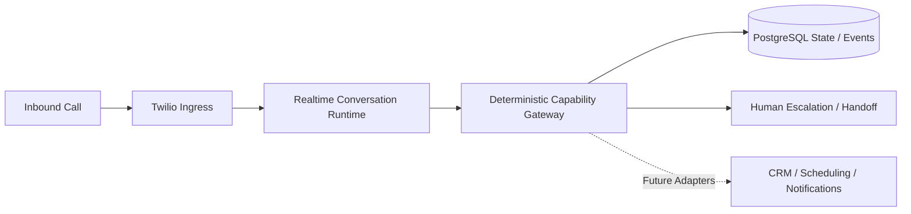

# RACB Voice Platform (ANA)

> **Governed realtime voice and telephony platform engineering with durable operational state, deterministic authority boundaries and controlled release preparation.**

| Attribute | Current evidence status |
|---|---|
| Evidence level | **Repository-Documented Implementation + Bounded Slice Validation** |
| Implementation repository | Private |
| Maturity | **Active Development — Staged Release, Cutover Not Established** |
| Primary capability | AI & Agentic Systems |
| Secondary capability | AI Operations & Governance |
| Telephony ingress | Twilio webhooks and bidirectional Media Streams |
| Realtime adapter | OpenAI Realtime |
| Operational store | PostgreSQL |
| Deployment engineering | Immutable packaging, staging/preflight and cutover-state foundations |
| Snapshot reviewed | 2026-10-10 |

## Overview

RACB Voice Platform, also known as ANA, is the operational foundation for a governed AI receptionist. It combines inbound telephony, realtime conversation, durable call state and human handoff with explicit controls on what automated components are permitted to do.

This is a **development-stage case study**, not a claim that the reviewed staged release has completed production cutover.

## The problem

A realtime voice agent can converse fluently without possessing the authority, durable state or operational safeguards needed to modify CRM records, schedule appointments or trigger customer-facing actions.

**Conversation capability ≠ authority to perform external business actions.**

## Architecture

The dashed adapter path is **future integration scope**, not evidence of completed production business side effects.

## Documented implementation

The private repository describes:

- Twilio inbound webhook and authenticated bidirectional Media Streams ingress.
- Call/stream correlation, lifecycle state and aggregate media counters.
- Operational events, explicit state contracts and database-backed idempotency.
- Human escalation queue and handoff packet.
- Minimal authenticated Handoff Console scaffold.
- Provider-neutral realtime conversation runtime and OpenAI Realtime adapter.
- Deterministic capability/authority boundary that rejects unsupported actions.
- Immutable release packaging and runtime release identity.
- Staging/preflight and crash-safe cutover journal/lock foundations.

## Validation evidence

The project README records validation for the operational foundation, telephony ingress and realtime voice slices, including a controlled live PSTN acceptance exercise.

That historical acceptance demonstrates a bounded realtime slice. It does **not** establish that the currently staged target release is production-deployed.

The reviewed README also describes a local VPS adapter/launcher bridge as uncommitted and not run on the VPS. No later cutover is asserted without additional release-specific evidence.

## Verified technology profile

| Area | Documented implementation |
|---|---|
| Telephony | Twilio inbound webhooks and Media Streams |
| Realtime conversation | Provider-neutral runtime + OpenAI Realtime adapter |
| Operational persistence | PostgreSQL |
| Call lifecycle | Durable state and operational events |
| Safety boundary | Deterministic capability/authority checks |
| Escalation | Human handoff queue and packet |
| Deployment | Release packaging, preflight and cutover-state foundations |
| Source control | Git / private GitHub repository |

## Capabilities demonstrated

- Telephony and realtime voice integration engineering.
- State and idempotency design for event-driven systems.
- Separation of conversational inference from business-action authority.
- Human escalation and controlled handoff.
- Release identity, staged deployment and failure-aware cutover preparation.
- Bounded validation claims and explicit operational limits.

## Deliberate boundaries

This snapshot does **not** establish:

- Production cutover of the documented staged target.
- Production-ready Twenty CRM, scheduling or n8n adapters.
- Full customer provisioning and deployment automation.
- Production-ready authentication and deployment of the Handoff Console.
- Persistent raw audio or full transcripts as a default behavior.

## Evidence classification

**REPOSITORY-DOCUMENTED IMPLEMENTATION** — the private repository describes the operational foundation, ingress, realtime runtime, deterministic gateway and deployment components.

**BOUNDED SLICE VALIDATION** — historical records cover foundation, ingress and controlled live realtime telephony acceptance within their documented scope.

**ACTIVE DEVELOPMENT** — the current staged release, production adapters and broader operational rollout are not represented as complete.

## Disclosure boundary

No credentials, private phone numbers, customer records, internal network details or proprietary implementation source are exposed in this public case.

## Interested in this architecture?

ANA is an internal RACBCONSULTING engineering platform under active development, not an open-source application release. The work demonstrates how realtime AI capability can be constrained by deterministic operational authority.

---

**Rene Canete / RACBCONSULTING**  
Technical Evidence Center
